# Pullback Architecture

This document shows how Pullback is put together, as Mermaid diagrams, with links to the code. For setup and the demo walkthrough, see [README.md](README.md).

1. [System overview](#1-system-overview)
2. [Recall pipeline](#2-recall-pipeline)
3. [Matching decision](#3-matching-decision)
4. [Approve and execute](#4-approve-and-execute)
5. [Per-order payout path](#5-per-order-payout-path)
6. [Incident state machine](#6-incident-state-machine)
7. [Action state machine](#7-action-state-machine)
8. [Storefront checkout](#8-storefront-checkout)
9. [Package photo check](#9-package-photo-check)
10. [Data model](#10-data-model)
11. [Frontend structure](#11-frontend-structure)
12. [Where the LLM sits](#12-where-the-llm-sits)

---

## 1. System overview

One Next.js app serves both the storefront and the owner dashboard. Every outside service is reached through one module: PayPal through `src/paypal/`, Gemini through `src/llm/client.ts`, openFDA through `src/recalls/openfda.ts`.

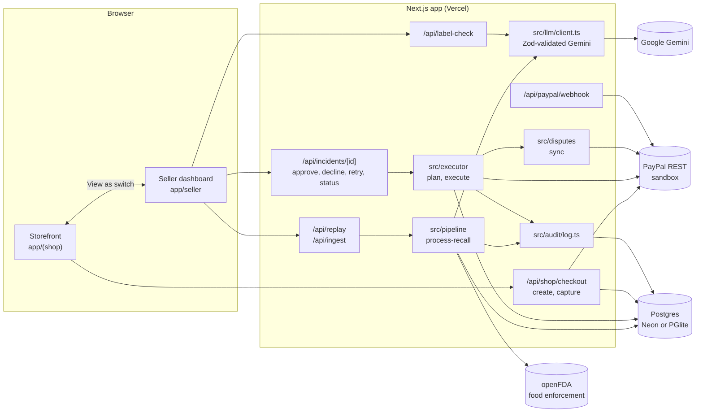

---

## 2. Recall pipeline

Runs daily (`POST /api/ingest`, or **Check the live FDA feed** on the overview) and on demand from replay fixtures. Code: [`src/pipeline/process-recall.ts`](src/pipeline/process-recall.ts).

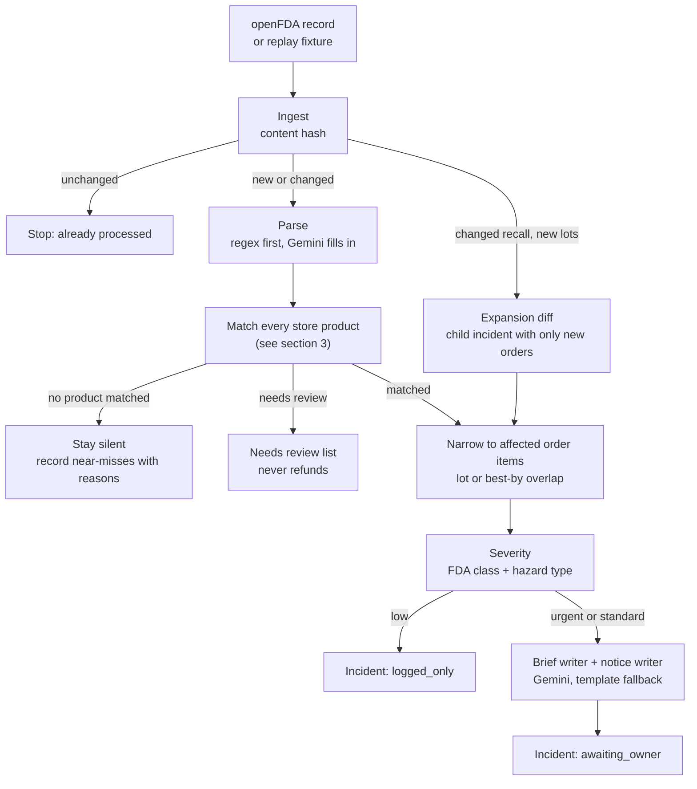

| Step | Deterministic? | File |
|---|---|---|
| Ingest and change detection | yes | [`src/recalls/fingerprint.ts`](src/recalls/fingerprint.ts) |
| Parse | regex first; Gemini values must appear in the text | [`src/recalls/parse.ts`](src/recalls/parse.ts) |
| Match | yes, Gemini only for partial signals | [`src/matching/identifiers.ts`](src/matching/identifiers.ts), [`fuzzy.ts`](src/matching/fuzzy.ts) |
| Narrow | yes | [`src/narrowing/narrow.ts`](src/narrowing/narrow.ts) |
| Severity | yes | [`src/severity/severity.ts`](src/severity/severity.ts) |
| Brief and notice text | Gemini, validated, template fallback | [`src/agents/`](src/agents/) |

---

## 3. Matching decision

The identifier-first matcher is a pure function. It returns a decision plus an evidence row per field (match, partial, mismatch, missing), which is exactly what the incident page and the package photo check display.

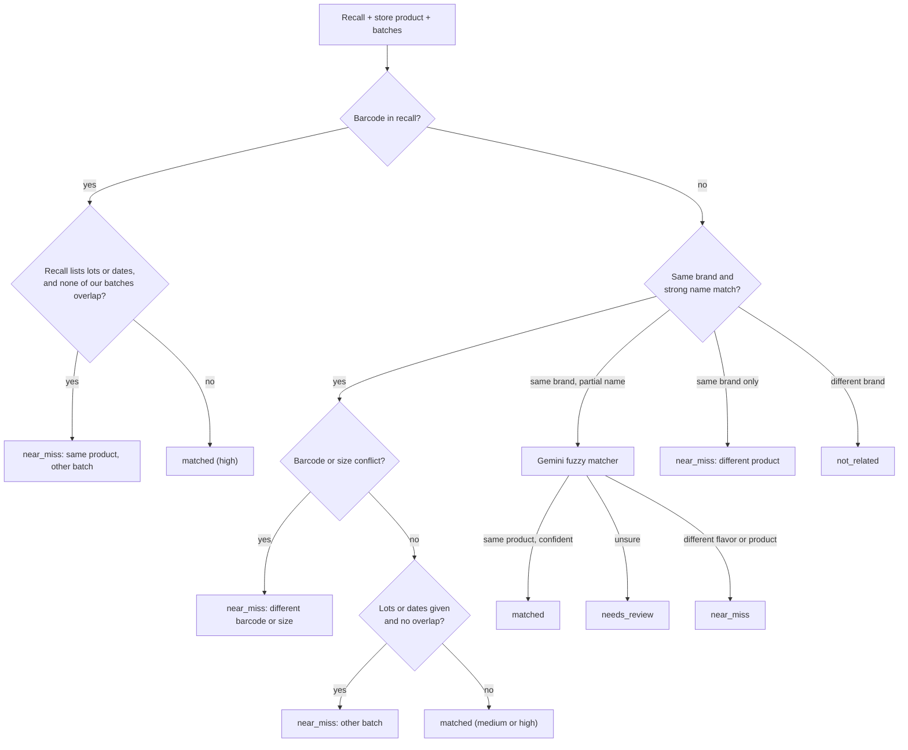

---

## 4. Approve and execute

The approve endpoint is the only way into PayPal writes. The response returns at once and execution continues with `after()`, so the incident page polls `/status` for live progress. Code: [`src/executor/execute.ts`](src/executor/execute.ts).

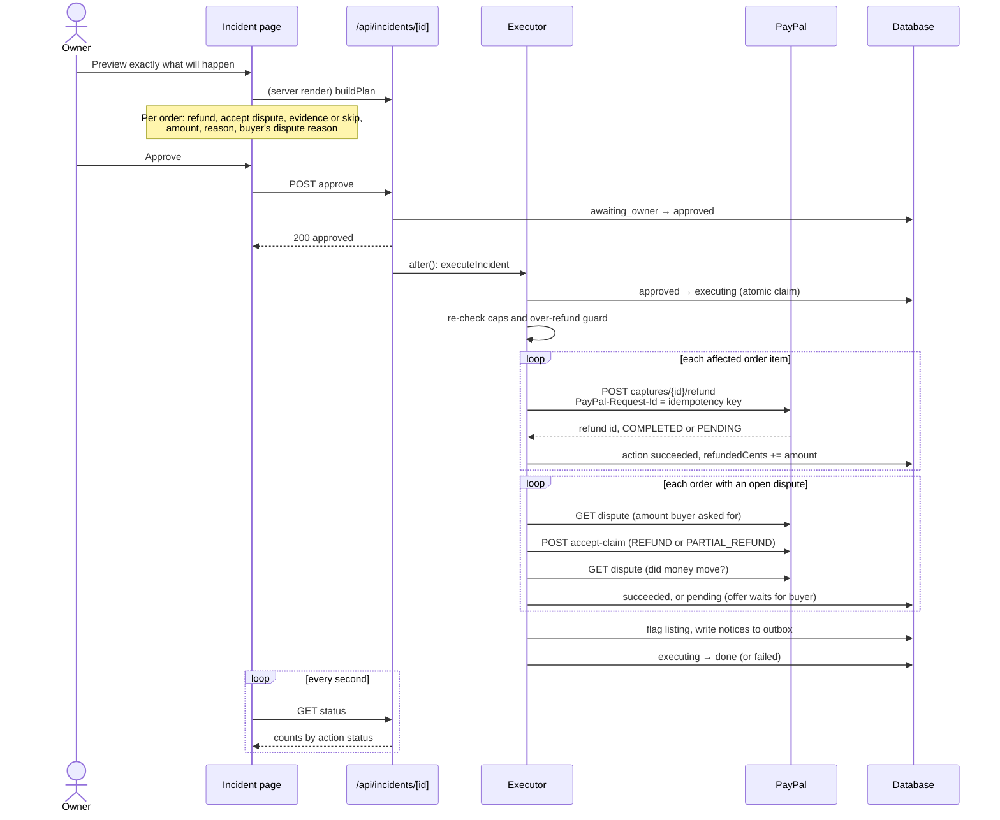

---

## 5. Per-order payout path

Each affected order takes exactly one path. Disputes are synced from PayPal (full `GET` per dispute, because the list endpoint omits the transaction ids) before the plan is built. Code: `buildPlan` in [`src/executor/execute.ts`](src/executor/execute.ts), [`src/disputes/sync.ts`](src/disputes/sync.ts).

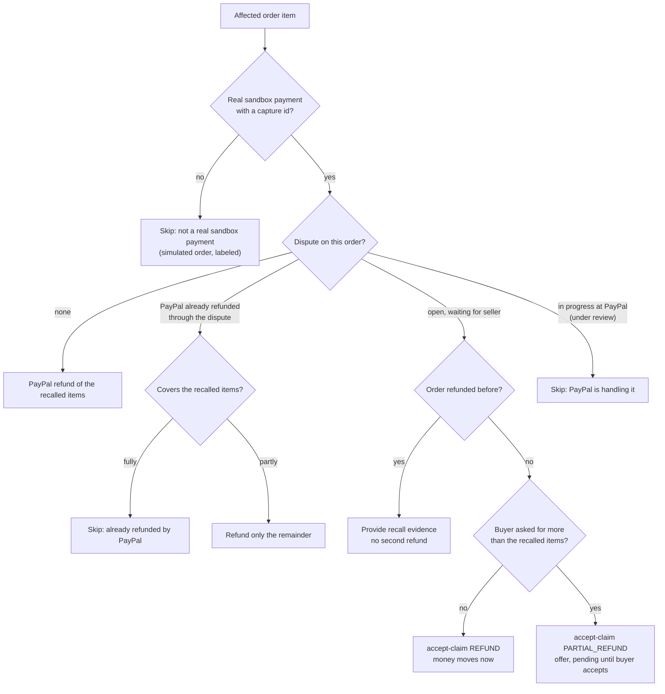

Every write above is guarded by:

- a deterministic idempotency key per incident, order and action type ([`src/executor/idempotency.ts`](src/executor/idempotency.ts));
- an over-refund check: captured minus already refunded, including dispute refunds;
- per-order and per-batch caps ([`src/executor/caps.ts`](src/executor/caps.ts)).

---

## 6. Incident state machine

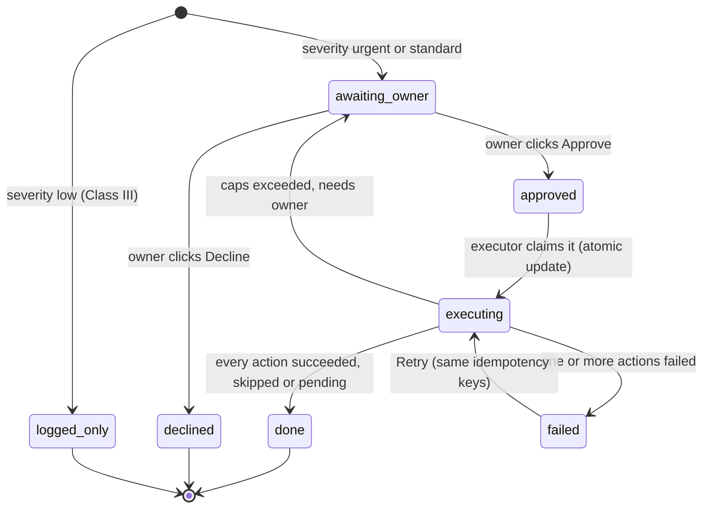

A retry reuses the same idempotency keys, so PayPal returns the original refund rather than paying again.

---

## 7. Action state machine

One row in `actions` per refund, dispute action, notice and listing flag.

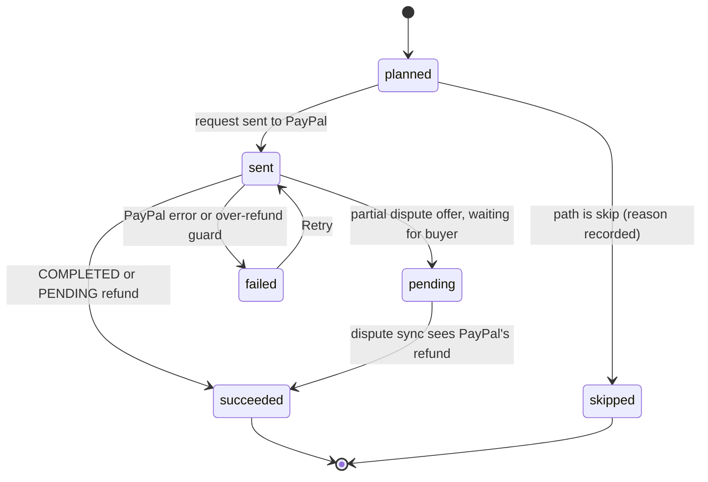

---

## 8. Storefront checkout

The server never trusts client prices, and no order row exists until PayPal has captured the money. Code: [`app/api/shop/checkout/`](app/api/shop/checkout/), [`src/paypal/orders.ts`](src/paypal/orders.ts).

```mermaid
sequenceDiagram
  actor Shopper
  participant Page as Checkout page
  participant Create as /api/shop/checkout/create
  participant Capture as /api/shop/checkout/capture
  participant PP as PayPal
  participant DB as Database

  Shopper->>Page: PayPal Buttons
  Page->>Create: items [{sku, qty}]
  Create->>DB: load prices, reject flagged (recalled) products
  Create->>PP: POST /v2/checkout/orders
  PP-->>Page: order id
  Shopper->>PP: approve in PayPal popup
  Page->>Capture: order id
  Capture->>DB: already recorded? return it (idempotent)
  Capture->>PP: POST capture, then GET order
  Capture->>DB: insert order + items from PayPal's item data,<br/>each item tied to the product's shelf batch
  Capture-->>Page: order id
  Page->>Shopper: My orders, with batch and capture id
```

Because each item is tied to the batch on the shelf, a purchase made live in the demo (the hero is sold from FTM-2508B) is caught by the real recall H-0836-2026.

---

## 9. Package photo check

The owner photographs a package on the shelf. Gemini only reads the label; the verdict comes from the same matcher as the recall pipeline, with the photo's lot and best-by as the only batch. Code: [`src/agents/label-reader.ts`](src/agents/label-reader.ts), [`src/matching/label-check.ts`](src/matching/label-check.ts).

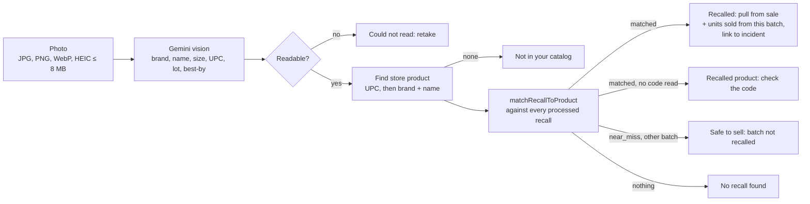

---

## 10. Data model

Drizzle schema: [`src/db/schema.ts`](src/db/schema.ts). Migrations in [`drizzle/`](drizzle/).

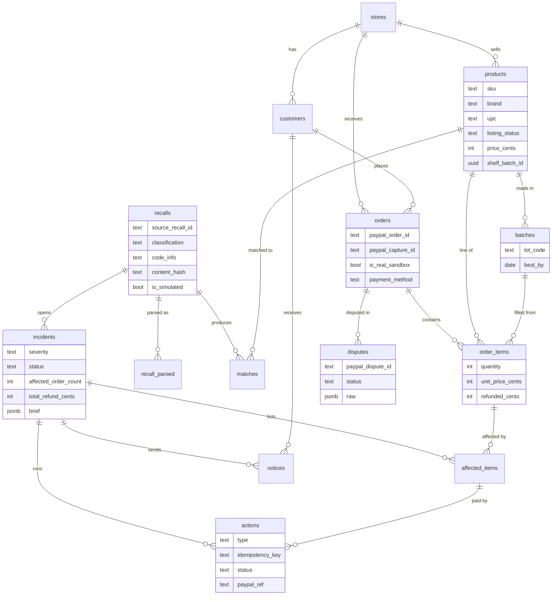

`audit_events` is append-only and stands apart: it records `actor`, `event_type` and a JSON payload for every PayPal call, AI call (model, prompt version, tokens, validity), approval, reset and photo check.

---

## 11. Frontend structure

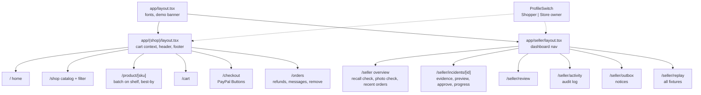

The cart lives in `localStorage` (wrapped in try/catch). Product images come from `public/products/`, generated by [`scripts/generate-product-images.ts`](scripts/generate-product-images.ts); any product without a photo falls back to a drawn SVG package.

---

## 12. Where the LLM sits

All Gemini calls go through [`src/llm/client.ts`](src/llm/client.ts): JSON schema output, Zod validation, one retry with the validation error, then `LlmUnavailableError` so the caller falls back. Every call is audited with model, prompt version and token counts. Prompts are versioned in [`src/agents/prompts/index.ts`](src/agents/prompts/index.ts).

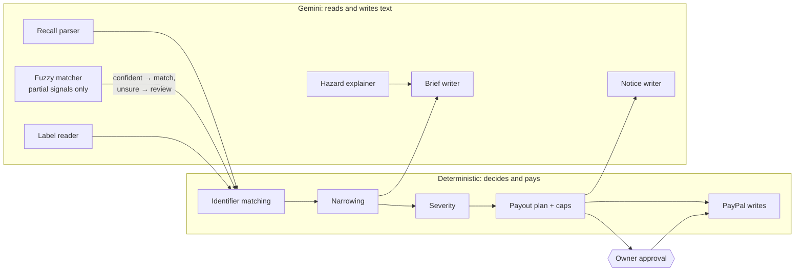

The model never calls a payment API, never sets the severity, and never chooses which orders are affected.
